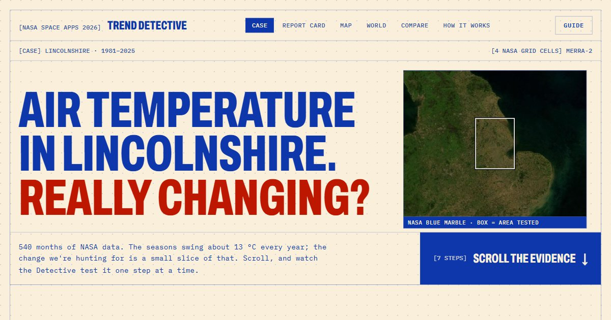

# Trend Detective: is it really changing?

**NASA Space Apps Challenge 2026 · "Be An Earth System Trend Detective!" · Team Paani Ke Batashe (Akshita Srivastava, Kanishk K. Sachan) · Lincoln, UK**

## ▶ Try the live demo

**https://kaakserver.tail042e87.ts.net/trend-detective/**

[](https://kaakserver.tail042e87.ts.net/trend-detective/)

No sign-in needed. It opens on a worked case (Lincolnshire warming); search any town, or pick another case card.

**30-second video:** [docs/demo/trend_detective_demo.mp4](docs/demo/trend_detective_demo.mp4) · **7-slide deck:** [docs/demo/trend_detective_slides.pdf](docs/demo/trend_detective_slides.pdf) · **Rebuild the headline number yourself:** [notebooks/reproduce_lincolnshire.ipynb](notebooks/reproduce_lincolnshire.ipynb)

Pick any place on Earth and a NASA variable (temperature, rain, soil moisture, haze, greenness and more). Trend Detective tells you honestly whether it is really changing or could be chance, then tries to break its own answer.

## What sets it apart

It has what the strongest projects in this challenge have: any place, tests corrected for "sticky" noise, a false-discovery check on maps, a world globe, a second NASA record, a sudden-jump test, El Niño removed, two places compared, plain and detailed wording, and citations. On top of that, it puts six things together in one tool:

1. **An instrument check for the documented changes in NASA's data sources** (2001 sunlight, cloud and heat radiation; 2014 aerosols; deep soil; 1987 rain), re-tested on single-source years. Worldwide, **42 of 88 proven cloud-cover trends could be the instrument, not the sky.**
2. **False alarms measured on monthly data:** 6% on pure noise vs 28–55% for a typical test, with 99.7% of real 0.3-per-decade trends still caught.
3. **Witnesses counted for independence:** station thermometers, rain gauges, GPCP, IMERG, ESA CCI, GLDAS, GRACE and ERA5, each labelled for how independent it is.
4. **Four ocean cycles removed together** (El Niño, NAO, Indian Ocean Dipole, PDO), with a careful "hidden change" flag.
5. **The world on trial:** 2,013 checks (111 places × 19 variables) show that 29% of typical trend claims don't hold. A luck test on 4,498 land squares: a typical test is fooled 22% of the time, ours 7%.
6. **Around 2050, three what-ifs:** our trend drawn on, 7 CMIP6 models and 3 IPCC emission paths, with a refusal when the change is one sudden jump.

Every number is computed from the data, never written by AI. Each case links to a CSV, the exact NASA request, NASA Giovanni and a notebook that rebuilds it.

---


## Run it yourself

**Backend** (Python 3.12, [uv](https://docs.astral.sh/uv/)):
```bash
cd backend
uv sync
uv run uvicorn trend_detective.api:app --port 8000
uv run pytest -q          # 71 tests, including synthetic data with known answers
```
No login is needed for NASA POWER. A few witnesses (GPM IMERG, GLDAS) need a free NASA Earthdata token in `backend/.env` (`EARTHDATA_TOKEN=...`, git-ignored). Responses are cached in `backend/data/cache/`, so the demo places load instantly.

**Website** (React + TypeScript, Vite):
```bash
cd frontend
npm install
npm run dev               # http://localhost:5173, talks to http://localhost:8000
```
Set `VITE_API_URL` to point it at another backend. Charts are hand-drawn SVG, the globe is d3-geo on a canvas, and the maps use Leaflet.

**Reproduce without our code:** [notebooks/reproduce_lincolnshire.ipynb](notebooks/reproduce_lincolnshire.ipynb) rebuilds the Lincolnshire verdict from the NASA POWER API alone (+0.333 °C per decade, the same as the site).

## Main API endpoints

All `GET`, CORS open. A place is a box: `lat_min`, `lat_max`, `lon_min`, `lon_max`. Example responses are in [`docs/examples/`](docs/examples/).

| Endpoint | What it returns |
|---|---|
| `/api/variables` | The 23 variables and their units |
| `/api/places?q=delhi` | Town search (GeoNames, 34,215 places), each with a ready box |
| `/api/analyse?var=T2M&…` | The verdict: Sen's slope with a 95% range, Hamed–Rao Mann–Kendall and least squares with an effective sample size, typical vs Detective, years still needed, links to reproduce it |
| `/api/cross-examine?var=…` | The sceptic's checks: instrument changes, El Niño and other ocean cycles, one year left out, two halves, every start/end year, seasons, sudden jump vs trend |
| `/api/witnesses?var=…` | Other records for the same place, each labelled for independence |
| `/api/outlook?var=…` | Around 2050: trend drawn on, CMIP6 models, IPCC emission paths |
| `/api/report-card?…` | Every variable for a place, sorted into proven, not yet, and none |
| `/api/map?var=…` | One trend per grid cell, typical vs false-discovery-corrected, plus a shuffled-years control |
| `/api/compare?var=…&a=…&b=…` | Whether two places are really changing differently |
| `/api/world`, `/api/globe?var=…` | The world report (111 places × 19 variables) and the 4,498-square globe with its luck test |
| `/api/validation` | The synthetic-data proof: false-alarm and detection rates |
| `/api/cite?var=…&name=…` | APA, Harvard and BibTeX references for a case |

Errors: 400 bad box, 404 unknown variable, 422 too little data, 502 a data source failed (the site shows "try again").

## Repo layout
```
backend/src/trend_detective/   the API: stats.py (every number), power.py (NASA POWER), crossexam.py,
                               witnesses.py, outlook.py, and one module per data source
backend/tests/                 tests, including synthetic data with known answers
backend/scripts/               the experiments behind the published numbers (validation, world report, globe)
backend/data/                  world report, globe grids, external NASA files and the response cache
frontend/src/                  the website
notebooks/                     reproduce a verdict without our code
docs/                          methods and references, findings write-ups, example responses, demo video and deck
```

## Data and credits
Full list with licence wording: [docs/methods.md → Data credits and licences](docs/methods.md#data-credits-and-licences).
- **NASA:** POWER (MERRA-2 / GMAO; CERES / GEWEX SRB), GPM IMERG V07, GPCP v3.3, GISTEMP v4, EONET, MODIS MOD13Q1/MYD13Q1 and MOD11A2/MYD11A2 v6.1 (LP DAAC, via Microsoft Planetary Computer). NASA does not endorse this project.
- **ERA5:** contains modified Copernicus Climate Change Service information [2026]; served by Open-Meteo (CC BY 4.0), which also serves CMIP6 HighResMIP model data.
- **ESA CCI Soil Moisture** v09.2 (Dorigo et al. 2017; Gruber et al. 2019). **Met Office HadCET** (© Crown copyright, Open Government Licence v3.0). **NOAA** CPC, PSL, NCEI indices and GHCN stations. **GeoNames** (CC BY 4.0).
- Methods: Mann (1945); Kendall (1975); Sen (1968); Hamed & Rao (1998); Yue & Wang (2004); Weatherhead et al. (1998); Benjamini & Hochberg (1995); Wilks (2016); full list in docs/methods.md.
- Libraries: pymannkendall, statsmodels, scipy, numpy, pandas, FastAPI, rasterio.

## AI use
Code was drafted with help from Claude (Anthropic) during the hackathon, and the team checked it with tests and synthetic experiments. Files with AI-assisted code say so in their header. Verdict numbers are always computed by code, never by the AI.
