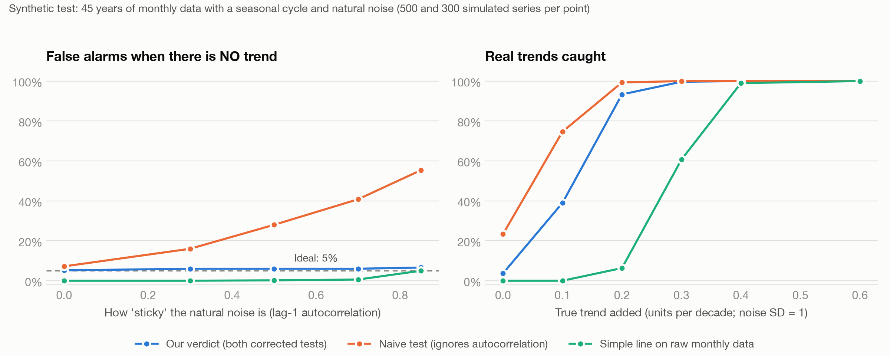

# Methods: how the Detective decides (DRAFT, for Akshita to edit and own)

## The question
Is this variable really changing here, or is it just natural ups and downs? If it is changing, how fast, and how sure are we? If we can't tell yet, how long until we could?

## 1. The evidence: NASA monthly data
- **Source:** NASA POWER (NASA Langley Research Center). It serves NASA's **MERRA-2** reanalysis (GMAO), which covers temperature, rain, soil wetness, humidity, wind and aerosols, and **CERES / GEWEX SRB** satellite data for sunshine and cloud. All monthly, **January 1981 to December 2025** (45 years, 540 months).
- **Area average:** for a chosen box we average every NASA grid cell inside it (0.5° × 0.625°). Each cell is weighted by its area (cosine of latitude).

## 2. Remove the seasons
Lincoln's monthly temperature swings by about 13 °C between winter and summer. The long-term change is about 1.5 °C, so it is hidden inside that swing. We subtract each calendar month's 45-year average. What is left, the **anomaly**, is the part that can show a trend.

## 3. Two independent tests, both corrected for "sticky" noise
Natural variability is **autocorrelated**: a warm month tends to be followed by another warm month. Standard tests assume every month is independent, so they become over-confident and see trends that aren't there. Our synthetic experiment (section 6) shows this.

| Test | What it does | Correction |
|---|---|---|
| **Mann-Kendall** (Mann 1945; Kendall 1975) | Rank-based: does the series go up more often than down? No assumption of a straight line or normal data; resistant to outliers. | **Hamed & Rao (1998)** variance correction, using autocorrelation up to 12 months |
| **Least-squares trend t-test** | The classic straight-line fit | **Effective sample size** n_eff = n(1 − r₁)/(1 + r₁), where r₁ is the residuals' lag-1 autocorrelation |

**Why 12 lags:** with the library default (all lags), random "significant" lags made the correction unstable. Our 95% intervals then covered the true trend only 86–90% of the time in synthetic tests. With lags up to 12 months, coverage was 92–95%.

## 4. How fast: Sen's slope with a 95% range
**Sen's slope** (Sen 1968) is the median of the slopes between every pair of months, so a few extreme months can't drag it. The 95% range comes from the corrected Mann-Kendall variance (Gilbert 1987). We report it **per decade, in real units**. For mostly-zero variables such as frost days, most pair slopes are exactly 0, so we use the corrected least-squares slope and interval instead, and say so.

## 5. The verdict
| Verdict | Rule |
|---|---|
| **Strong evidence** | Both corrected tests p < 0.01 |
| **Some evidence** | Both corrected tests p < 0.05 |
| **Mixed** | One test p < 0.05, the other not |
| **Not significant yet** | Neither test p < 0.05, but at this rate it would show within 100 years |
| **No meaningful trend** | Neither significant, and it would take more than 100 years |

Requiring **both** tests to agree keeps false alarms at about 5% (section 6).

## 6. Proof it works (synthetic data with known answers)
We generated 45-year monthly series with a seasonal cycle and autocorrelated noise, where we know the true trend.

**No real trend** (500 series per setting): how often does each method wrongly claim one?

| Noise "stickiness" r₁ | 0.0 | 0.3 | 0.5 | 0.7 | 0.85 |
|---|---|---|---|---|---|
| Naive test (ignores autocorrelation) | 7% | 16% | 28% | 41% | **55%** |
| **Our verdict** | **5%** | **6%** | **6%** | **6%** | **7%** |
| Simple line on raw monthly data | 0% | 0% | 0% | 1% | 5% |

**Real trend** (r₁ = 0.5, noise SD 1, 300 series each): how often is it caught?

| True trend per decade | 0 | 0.1 | 0.2 | 0.3 | 0.4 |
|---|---|---|---|---|---|
| Naive test | 23% (false alarms) | 75% | 99% | 100% | 100% |
| **Our verdict** | **4%** | **39%** | **93%** | **100%** | **100%** |
| Simple line on raw monthly data | 0% | 0% | 6% | 61% | 99% |

**Reading it:** the naive test "finds" trends that don't exist. The simple raw-data line almost never raises a false alarm, but it misses real trends because the seasons drown them. Ours keeps false alarms near the promised 5% **and** still catches real trends.

**Starting point:** NASA GES DISC's own published approach (Acker et al., SeaWiFS chlorophyll time series) fits a least-squares line to monthly Giovanni data and tests it with an F-test. We build on it with seasonal removal, a robust slope, autocorrelation correction and multiple-testing control.

## 6b. Cross-checks against other records (real data, same engine)
| Check | Other record | NASA (via POWER) | Monthly anomaly correlation |
|---|---|---|---|
| **Temperature, Central England, 1981–2025** | Met Office HadCET (thermometers): **+0.31 °C/decade** (0.21 to 0.41), strong | MERRA-2 T2M, 25 cells: **+0.32 °C/decade** (0.21 to 0.43), strong | **0.99** |
| **Rainfall, Lincoln box, 1983–2025** | NASA GPCP v3.3 (satellite + gauges): +0.031 mm/day/decade, not significant yet | MERRA-2 PRECTOTCORR, 15 cells: +0.029 mm/day/decade, not significant yet | **0.97** |

| **Soil moisture, 1992–2024** (Space Agency partner data) | **ESA CCI Soil Moisture COMBINED v09.2** (satellite microwave, daily → monthly, months with ≥5 valid days) | MERRA-2 topsoil wetness | 0.38 (Lincoln box) to 0.74 (Iberia) |

**Soil moisture:** NASA and ESA agree that **no region we tested (Lincoln, England & Wales, Iberia, Northern Europe) shows a significant soil-moisture trend since 1992.** Their month-to-month agreement is only moderate (r = 0.4–0.7). They measure different things: ESA sees the top few centimetres from space, while MERRA-2 is a model's topsoil layer in different units. At grid-cell level they disagree. ESA flags 39 of 205 England cells after the correction (16 wetter, 23 drier), while MERRA-2 flags none. Satellite soil-moisture records can contain jumps when sensors change, so we treat single-cell soil trends as **"needs a second witness"**, not a finding.

MERRA-2 does not assimilate land station air temperatures, so the HadCET agreement is close to an independent confirmation. MERRA-2's corrected rainfall partly uses gauge and GPCP information, so the rainfall agreement shows consistency, not independence.

## 7. How long until we'd know?
For trends that are not significant yet, we estimate the years of monthly data needed to detect a trend of the current size (5% level, 90% probability), following **Weatherhead et al. (1998)**:

n* ≈ [ (3.3 σ / |ω|) · √((1 + φ)/(1 − φ)) ]^(2/3)

Here ω is the trend per year, σ is the monthly noise standard deviation and φ is its lag-1 autocorrelation. Example: Lincolnshire wind speed is falling slightly, but not significantly yet; at that rate it needs about 69 years of data, so about 24 more.

## 8. Maps: many tests at once
Testing 150 grid cells at the 5% level gives about 7 "significant" cells by pure chance. We control the **false discovery rate** with Benjamini & Hochberg (1995) at q = 0.10, as recommended for climate maps by Wilks (2016).

**Real example:** root-zone soil wetness over England and Wales, 137 cells. **18** look significant on their own; **0** survive the correction. Without the correction we would have reported a drying or wetting signal that isn't there.

## 9. What this does *not* tell you
- **Trend ≠ cause.** We detect change; we don't attribute it.
- **MERRA-2 is a reanalysis:** a model constrained by observations. Soil wetness and evaporation are model estimates.
- **Straight-line trends** summarise 45 years; real change can speed up, slow down or jump (for example after a change in the satellite record).
- **Grid cells are about 50 km.** Your street may differ.

## References
- Benjamini, Y. & Hochberg, Y. (1995). Controlling the false discovery rate. *J. R. Stat. Soc. B* 57, 289–300.
- Gilbert, R. O. (1987). *Statistical Methods for Environmental Pollution Monitoring*. Van Nostrand Reinhold.
- Hamed, K. H. & Rao, A. R. (1998). A modified Mann-Kendall trend test for autocorrelated data. *J. Hydrology* 204, 182–196.
- Kendall, M. G. (1975). *Rank Correlation Methods*. Griffin.
- Mann, H. B. (1945). Nonparametric tests against trend. *Econometrica* 13, 245–259.
- Sen, P. K. (1968). Estimates of the regression coefficient based on Kendall's tau. *JASA* 63, 1379–1389.
- Weatherhead, E. C. et al. (1998). Factors affecting the detection of trends. *J. Geophys. Res.* 103(D14), 17149–17161.
- Wilks, D. S. (2016). "The stippling shows statistically significant grid points". *BAMS* 97, 2263–2273.
- Yue, S. & Wang, C. (2004). The Mann-Kendall test modified by effective sample size. *Water Resour. Manage.* 18, 201–218.
- Acker, J. G. et al. Time-series analysis of SeaWiFS chlorophyll (NASA GES DISC, NTRS).
- NASA POWER Project, power.larc.nasa.gov. Gelaro, R. et al. (2017), MERRA-2, *J. Climate* 30, 5419–5454.
